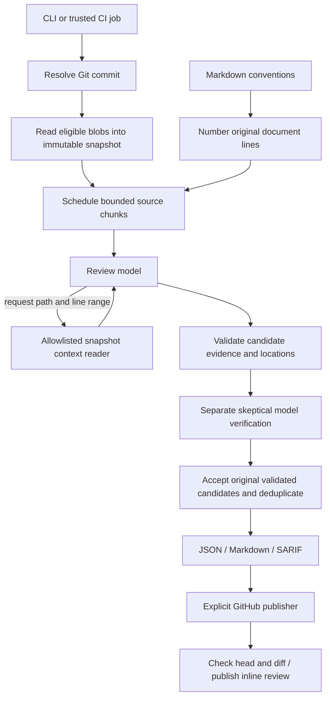

# Automated Code Review Agent

Review a Git repository against your Markdown coding conventions and receive actionable code-quality and adherence findings with **exact file paths and one-based line numbers**.

Supports **OpenAI** and **Anthropic**, local repositories and HTTPS Git URLs, Markdown/JSON/SARIF output, and optional inline GitHub pull-request reviews.

This is a working CLI agent and GitHub Actions integration. It reads committed source, requests additional context when useful, verifies candidate findings in a separate model pass, and validates locations and evidence in code. It does not execute the target repository.

## 1. Install

Requirements: Python 3.11+ and Git on PATH. The runtime uses Python's standard library; installation uses setuptools.

```bash
git clone https://github.com/rahul-phull3/automated-code-review-agent.git
cd automated-code-review-agent
python -m venv .venv
# Linux/macOS:
source .venv/bin/activate
# Windows PowerShell:
# .venv\Scripts\Activate.ps1
python -m pip install .
review-agent --help
```

You can also run from the project directory without installation:

```bash
python -m review_agent --help
```

## 2. Configure a provider

Choose a model available in your account that supports structured JSON outputs. Model IDs are intentionally explicit; there is no hardcoded model or assumed account access.

For OpenAI, set `OPENAI_API_KEY`. For Anthropic, set `ANTHROPIC_API_KEY`. Configure secrets through your shell, secret manager, or CI secret settings; do not commit them. The application does not automatically load .env files.

Linux/macOS, with credentials already configured securely:

```bash
export REVIEW_MODEL='your-model-id'
```

PowerShell:

```powershell
$env:REVIEW_MODEL = 'your-model-id'
```

Only the selected provider's key is required. The same review engine works with either provider.

## 3. Write your conventions

Use ordinary Markdown. Include scope, exceptions and examples where needed:

```markdown
# Python conventions

- Use the logging module instead of print statements in application code.
- Never use mutable default arguments.
- Public functions must document their return values.
- Test fixtures may use print for debugging.
```

See [examples/CONVENTIONS.md](examples/CONVENTIONS.md).

The full document is numbered and supplied without rewriting its requirements into an invented rule set. Every accepted convention finding quotes the original document and cites its line range. General code-quality findings are labeled separately and have no convention citation.

The document must be nonempty UTF-8 and at most 60,000 bytes. Keep it focused on coding requirements.

## 4. Preview the files that will be sent

```bash
review-agent review /path/to/repository \
  --conventions /path/to/CONVENTIONS.md \
  --provider openai --model "$REVIEW_MODEL" \
  --inventory-only
```

Inventory mode makes no model calls and needs no API key. It lists eligible and excluded files at the selected Git commit. Add repeatable `--exclude` globs to refine the scope:

```bash
review-agent review /path/to/repository \
  --conventions /path/to/CONVENTIONS.md \
  --provider openai --model "$REVIEW_MODEL" \
  --exclude 'tests/*' --exclude 'generated/*' --inventory-only
```

Only tracked files at `--ref` (default HEAD) are reviewed. Uncommitted and untracked changes are not included. Commit the code you intend to review or point at an existing commit.

## 5. Run a review

OpenAI, local repository:

```bash
review-agent review /path/to/repository \
  --conventions /path/to/CONVENTIONS.md \
  --provider openai --model "$REVIEW_MODEL" \
  --output reports --fail-on warning
```

Anthropic, remote repository:

```bash
review-agent review https://github.com/OWNER/REPOSITORY.git \
  --conventions examples/CONVENTIONS.md \
  --provider anthropic --model "$REVIEW_MODEL" \
  --ref main --max-calls 60 --output reports
```

PowerShell single-line equivalent:

```powershell
review-agent review C:\code\my-repo --conventions C:\code\CONVENTIONS.md --provider openai --model $env:REVIEW_MODEL --output reports
```

Remote sources are cloned as bare repositories in a temporary directory, without checkout or submodule initialization. Use an authenticated local clone for private repositories. Embedded credentials in URLs are rejected.

### Outputs

| File | Purpose |
| --- | --- |
| review.md | Human-readable findings, evidence, convention references and skipped files |
| review.json | Machine-readable findings, coverage, errors, commit, document hash and usage |
| review.sarif | SARIF 2.1.0 locations for code-scanning tools |

Each finding contains:

- Repository-relative path and inclusive start/end line numbers.
- Category: convention or quality.
- Severity: error, warning or note; confidence between 0 and 1.
- Title, concrete explanation, remediation suggestion and exact source evidence.
- Original convention line range and exact quote, when applicable.
- Stable fingerprint for identical finding identity.

Example location: `src/service.py:42-45`. Locations refer to the immutable commit recorded in the report.

Exit codes:

| Code | Meaning |
| --- | --- |
| 0 | Complete within configured scope, no finding at/above failure threshold |
| 1 | Complete review with findings meeting `--fail-on` |
| 2 | Invalid input, operational failure or incomplete review |

`--fail-on none` disables the finding threshold; incomplete reviews still exit 2. No findings is not a proof that the code is correct.

## 6. Publish inline GitHub PR comments

Review the exact PR head commit. If reviewing locally, fetch the pull-request head into your repository first:

```bash
git -C /path/to/repository fetch origin pull/123/head
review-agent review /path/to/repository --ref FETCH_HEAD \
  --conventions /path/to/CONVENTIONS.md \
  --provider openai --model "$REVIEW_MODEL" --output reports
```

Inspect the generated artifacts. Configure `GITHUB_TOKEN` with access to the target repository and **Pull requests: write** permission. Then explicitly publish:

```bash
review-agent publish reports/review.json --repo OWNER/REPOSITORY --pr 123
```

The publisher:

1. Requires a completed report.
2. Checks that the PR is open and its head SHA matches the reviewed commit.
3. Retrieves all changed files and existing review comments with pagination.
4. Places comments on added RIGHT-side lines only; each comment includes the full finding range.
5. Keeps findings outside added lines, missing/truncated patches, and beyond the 50-comment cap in the report.
6. Checks the head again immediately before submitting a COMMENT review anchored to the SHA.
7. Uses report and finding markers to avoid duplicates on sequential reruns.

It never approves, requests changes, merges or edits source. Full report artifacts should accompany the PR review; the publisher does not upload report files. Concurrent publishers can still race: serialize runs for the same PR. If the head changes after the final check, GitHub anchors comments to the older SHA. Publishing is a separate command and must be authorized by whoever runs it.

Only publish reports produced by your trusted review process; imported JSON is not a signed attestation. API write requests are not automatically retried because a timeout can occur after GitHub accepted the review. Inspect the PR and rerun if needed; markers handle most sequential duplicates.

## 7. Automate across repositories

### Included Actions workflow

1. Open this repository's Settings -> Secrets and variables -> Actions.
2. Add `OPENAI_API_KEY` and/or `ANTHROPIC_API_KEY`.
3. Replace the example conventions with your team's rules, or change the convention path in the workflow.
4. Open Actions -> **Review a repository** -> Run workflow.
5. Enter the HTTPS target Git URL, ref, provider and model ID.
6. Download the **code-review** artifact containing all three report formats.

The workflow uses the trusted reviewer checkout and reads the target as Git data. It does not install dependencies from the target or run target code. It has read-only repository permissions, a 30-minute timeout and a 60-call budget. Findings at error severity fail the job; artifacts are uploaded even when review exits nonzero.

Repeat this workflow for different repositories, or use the CLI in your organization's existing CI. A fleet can use a CI matrix of repository URLs and convention paths. Use separate output directories and centrally managed API secrets.

### Automatic PR triggers

For production PR automation, run a pinned trusted installation of this reviewer, fetch the PR head without executing it, review the exact SHA, retain artifacts, then explicitly call the publish command using a restricted token. Serialize jobs per repository/PR. Keep conventions in a trusted location when PR authors must not alter review policy.

Do not install or execute the proposed PR's reviewer code with privileged secrets. Fork PRs normally do not receive Actions secrets: use a deliberate trusted orchestration process rather than weakening secret boundaries. The included workflow is manually dispatched; an always-on webhook server/GitHub App is not included.

## System design and architecture



### Components

| Module | Responsibility |
| --- | --- |
| source.py | Resolve refs, enumerate Git tree, read immutable blobs, exclusions, evidence validation |
| agent.py | Chunk scheduling, context loop, structured finding schemas, verification and completeness |
| providers.py | OpenAI Responses / Anthropic Messages adapters, HTTP handling, retries, usage counters |
| reports.py | Human-readable and machine-readable report serialization |
| github.py | Diff eligibility, commit checks, pagination, duplicate markers and PR review submission |
| cli.py | Argument validation, remote cloning, orchestration and exit codes |

### Agent lifecycle

1. Resolve the requested revision to an immutable commit SHA; read Git blobs instead of live filesystem paths.
2. Preserve accepted UTF-8 files in memory. Symlinks and submodules are skipped.
3. Divide files into contiguous numbered chunks. Include an inventory of eligible paths.
4. Supply the original numbered convention document and current chunk to the model.
5. If context is needed, the model returns a structured request containing path/start/end. The application resolves only ranges within the in-memory snapshot.
6. Repeat up to the context-round limit. Reject a run segment if the model still requests context after exhaustion.
7. Validate each candidate's source range and exact excerpt, category, severity, confidence and convention quote.
8. Ask a separate model call to remove unsupported candidates. The verifier cannot introduce or modify findings.
9. Deduplicate accepted findings by path, range, category and title.
10. Record coverage and errors and emit reports. A failed chunk does not erase already accepted findings, but the report is incomplete.

The model chooses which extra context to inspect; the host controls allowed actions and budgets. There is no shell tool, file-write tool, network browsing tool or autonomous publishing tool available to the model.

### Bounds and defaults

| Resource | Default |
| --- | --- |
| Source blob size | 150,000 bytes |
| Total accepted source bytes | 5,000,000 bytes |
| Convention document | 60,000 bytes |
| Chunk size | 180 lines; configurable 1–500 |
| Chunks per review | 100; configurable |
| Model calls | 100; configurable |
| Context rounds per chunk | 2; configurable 0–5 |
| Context ranges per round | Up to 3, each at most 120 lines |
| Candidates per chunk | Up to 20 |
| Confidence threshold | 0.8 |
| Model output budget | 6,000 tokens per call |
| HTTP timeout | 90 seconds per attempt |
| Transient HTTP retries | Up to 3 attempts with bounded backoff |
| Published inline comments | Up to 50 |

A model-call budget counts logical requests; retry attempts can increase actual HTTP requests to at most three times that count. Verification consumes the same call budget. Token usage reported by successful API responses is accumulated; unsuccessful or retried requests may incur additional cost not reflected in the report. This is a call bound, not a monetary spending guarantee.

There is no persistent cache or database. Artifacts are the durable record, including commit and convention hash. Each invocation is independent, making repository isolation and CI concurrency straightforward. For large repositories, narrow scope with exclusions or raise budgets deliberately.

### Trust boundaries and privacy

Reviewed code, comments, filenames, convention documents and model outputs are untrusted data. System prompts instruct models to treat them accordingly; deterministic path/evidence checks constrain outputs. Prompt injection remains possible at the semantic level, so human review is required.

Eligible source, inventory paths and conventions are sent to the selected provider. Common secrets files (.env*, .pem, .key, .p12), build/vendor directories, lock files, binaries and non-UTF-8 files are skipped by default. These exclusions are not a secret scanner: secrets embedded in ordinary source can still be sent. Use inventory mode and custom exclusions before reviewing sensitive code.

Code and model responses are not written to debug logs. Accepted evidence appears in report artifacts and, if published, review comments. Apply appropriate artifact access and retention settings. OpenAI requests set `store=false`; this is not a claim about account-specific retention guarantees.

### Failure behavior and tradeoffs

- Unsupported model/schema, authentication, refusal and truncated output become explicit errors.
- HTTP 429 and selected 5xx responses receive bounded retries. Authentication failures do not.
- Empty repositories, exhausted chunk/call budgets, failed chunks and size-budget exclusions produce incomplete reports.
- Intentional exclusions and unsupported file formats are listed; completeness is scoped to eligible files.
- Chunk boundaries may miss issues spanning distant code. Context requests help but do not guarantee discovery.
- Language-agnostic text review supports many languages, with quality dependent on the selected model. There is no AST index, compiler, runtime execution or guarantee of equivalent quality across languages.
- Verification reduces false positives but uses the same provider/model; it is not independent proof.
- Confidence is model-reported, not calibrated probability.
- Exact quoted evidence proves location grounding, not that a semantic criticism is correct.
- Deduplication is deterministic for identical titles/locations, not semantic across differently worded findings.
- Remote clone timeout is bounded; clone disk consumption is not capped. Use controlled runners and local clones for very large repositories.
- No web dashboard, hosted queue, webhook service, automatic source fixing or repository fleet database is included.

## Development and testing

```bash
python -m unittest discover -s tests -v
python -m compileall -q review_agent
python -m review_agent --help
```

Tests use temporary Git repositories, a scripted model provider and mocked HTTP. They cover committed-source isolation, invalid evidence, convention citations, context bounds, verification failures, provider request contracts, retry behavior, report generation, PR head checks, diff eligibility and sequential duplicate prevention.

The included CI runs tests on Linux and Windows with Python 3.11, 3.12 and 3.13.

Live model calls are deliberately not part of offline CI. Configure a real key and model, review the deliberate problems in examples/bad_app.py, inspect findings and evaluate against your own labeled examples before using findings as a merge gate. A stronger evaluation suite should measure precision/recall per convention and language and include prompt-injection fixtures.

### Add another provider

Implement the provider interface used by the engine:

- `complete(system, data, schema) -> dict`
- Fields `name`, `model`, `calls`, `max_calls`, `usage`
- Raise `ProviderError` on refusals, budget exhaustion or invalid responses.

Register it in the CLI. Keep the same schemas and deterministic validation so provider changes cannot bypass evidence checks.

## Troubleshooting

| Symptom | Resolution |
| --- | --- |
| Git operation failed | Confirm it is a Git repository with a commit and that the requested ref exists locally |
| Missing API key | Configure the selected provider's environment variable in the process running the CLI |
| HTTP 400 | Check model support for structured JSON outputs and account access |
| HTTP 401/403 | Check provider key or GitHub token permissions |
| Incomplete review | Inspect errors and coverage in review.json; adjust scope/budgets or fix API failures |
| PR head changed | Fetch current PR head and rerun against its exact SHA |
| No inline comments | Findings may be outside added lines or patches unavailable; inspect the full report |
| Private clone fails | Authenticate Git locally and supply the local repository path |
| Windows temporary-directory issue | Set TEMP/TMP to a writable scratch directory before running |

## API references

- [OpenAI structured outputs](https://developers.openai.com/api/docs/guides/structured-outputs)
- [Anthropic structured outputs](https://platform.claude.com/docs/en/build-with-claude/structured-outputs)
- [GitHub pull-request reviews](https://docs.github.com/en/rest/pulls/reviews#create-a-review-for-a-pull-request)

See [PLAN.md](PLAN.md) for the milestone delivery plan.
